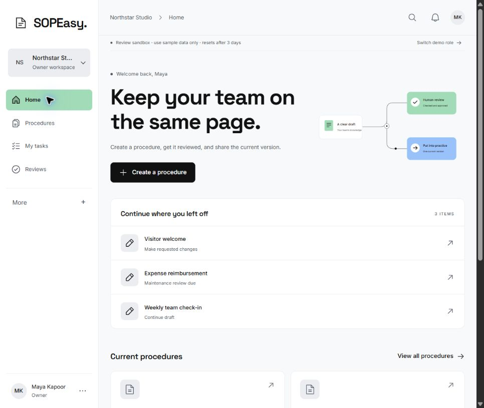

# SOPEasy

Turn process notes into procedures your team can review, publish and acknowledge.

SOPEasy is an office operations and HR workspace. AI helps organize the draft; the process owner and a separate reviewer control what the team receives.

[Open the team review app](https://sopeasy-review.vercel.app/) · [Deployment guide](REVIEW-DEPLOYMENT.md) · [Implementation notes](IMPLEMENTATION.md)



## The workflow

1. **Create:** Add a title and process notes. Draft manually or prepare an AI proposal.
2. **Review:** Edit the draft and send it to a reviewer who has not edited it. The reviewer can approve it or request changes.
3. **Publish:** Publish the approved revision and assign the current version to readers.
4. **Acknowledge:** Readers confirm that they have read that version. Owners can inspect receipts and export a report.

Changes start a new working revision. The published version remains available while the next revision goes through review.

## Features

- Procedure templates, source notes, ordered steps and checklists.
- Gemini or Sarvam proposals, section rewrites, source references and questions for unresolved facts.
- Autosave, checkpoints and recovery when a saved revision changes.
- Independent approval, numbered publication history and version-specific acknowledgements.
- Search, reading assignments, maintenance dates, archive and restoration.
- PDF export, acknowledgement CSV and workspace JSON export.

The interface keeps **Home, Procedures, My tasks and Reviews** visible. Secondary tools sit under **More**. Restrained pastel colors, Space Grotesk headings and Inter body text carry through desktop and mobile.

## Engineering approach

The backend enforces the procedure lifecycle through explicit state transitions and validation. These checks run on the server, including when a caller sends requests directly to the API.

| Rule                                                               | Implementation                                                                                          |
| ------------------------------------------------------------------ | ------------------------------------------------------------------------------------------------------- |
| Restrict actions to the right workspace and role                   | [API access checks](server/app.mjs) and [domain permissions](server/domain.mjs)                         |
| Prevent editors from approving their own changes                   | [Review rules](server/domain.mjs)                                                                       |
| Publish only the exact approved revision                           | [Publication rules](server/domain.mjs), content hashes and transactional updates                        |
| Tie reading receipts to a person and published version             | [Acknowledgement rules](server/domain.mjs)                                                              |
| Validate AI output against saved source evidence before acceptance | [Grounding](server/grounding.mjs), [proposal validation](server/ai.mjs) and immutable request snapshots |

AI proposes how to organize supplied evidence. The application constructs procedure text from that evidence and validates the proposal before acceptance. Exceptions and completion checks remain separate from operational steps. Conflicting instructions require clarification; AI cannot approve, publish or acknowledge a procedure.

## Stack

| Layer    | Technology                                             |
| -------- | ------------------------------------------------------ |
| Frontend | React 19, Vite, Phosphor icons                         |
| Backend  | Node.js 24+, Express                                   |
| Database | SQLite, using Node's built-in SQLite API               |
| AI       | Gemini or Sarvam, configured on the server             |
| Hosting  | Vercel frontend with `/api` requests proxied to Render |

## Run locally

You need **Node.js 24 or newer**.

```bash
git clone https://github.com/SakshamSinghal20/sopeasy.git
cd sopeasy
npm ci
```

Copy `.env.example` to `.env` for a fresh setup. Preserve an existing `.env`.

```powershell
Copy-Item .env.example .env
npm run dev
```

Open [localhost:4197](http://localhost:4197). The local demo uses fictional people: Maya is the owner, Arjun is the reviewer, and Leena is the reader. Use the role switcher to test the lifecycle.

### Enable AI

For Gemini, set these values in the backend's private environment:

```dotenv
AI_PROVIDER=gemini
GEMINI_API_KEY=your-provider-key
AI_DISABLED=false
```

For Sarvam, use `AI_PROVIDER=sarvam` and `SARVAM_API_KEY`. Manual drafting works without a provider key. Keep keys on the backend and outside version control. See [.env.example](.env.example) for model and token settings.

### Check the implementation

```bash
npm run verify
```

The test suite covers permissions, review and publication rules, versioned receipts, concurrent edits, AI validation, cancellation, stale proposals, checkpoint recovery and exports. [GitHub Actions](.github/workflows/verify.yml) also builds and starts the actual Docker image to check backend readiness.

For AI fixture evaluation, run `node scripts/evaluate-ai.mjs --list` or `--self-test`. Add `--live` to call the configured provider; live evaluation uses your provider credits. `--replay <report.json>` checks a saved evaluation without new provider calls.

## Deployment status

The hosted app is a **sample-data review sandbox**. Each browser gets an isolated workspace with fictional roles; it does not provide a shared company workspace or authenticate employees.

- Gemini is enabled on the hosted backend; email and account flows are disabled in the review build.
- Sandboxes expire after three days. Free Render storage can also reset on restarts or deployments.
- The backend may take time to wake after inactivity. Use fictional notes only.

For real company use, deploy with authentication enabled, configure email delivery, attach durable storage and verify off-host backup restoration. Use [production.env.example](production.env.example) and the [deployment guide](REVIEW-DEPLOYMENT.md).

## Project guide

| Path                   | Purpose                                               |
| ---------------------- | ----------------------------------------------------- |
| `src/`                 | React interface and shared visual styles              |
| `server/domain.mjs`    | Procedure lifecycle and business rules                |
| `server/app.mjs`       | API routes, access checks and transactions            |
| `server/grounding.mjs` | Evidence-based AI layout and validation               |
| `server/db.mjs`        | SQLite persistence                                    |
| `tests/`               | Domain, API, provider and regression tests            |
| `scripts/`             | AI evaluation, benchmarks and verified SQLite backups |

Read [PRODUCT.md](PRODUCT.md) for the audience and constraints, [DESIGN.md](DESIGN.md) for the visual system, and [IMPLEMENTATION.md](IMPLEMENTATION.md) for implementation details and release checks. `npm run backup` creates and verifies a local SQLite snapshot; real deployments also need off-host backup storage. Private credentials, databases and `.qa/` reports are excluded from Git.
